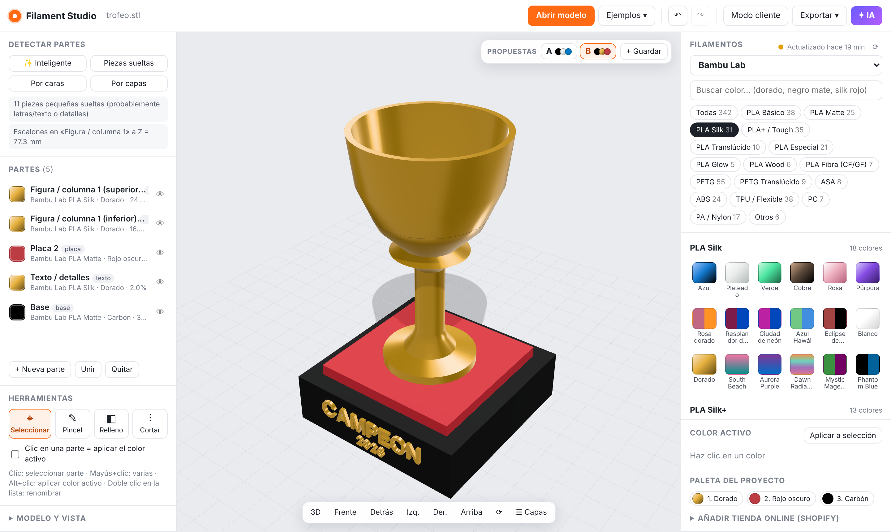

# Filament Studio

Personalizador de color **en tiempo real** para piezas de impresión 3D. Subes el modelo «en blanco» (STL, 3MF, OBJ…), la app detecta sus partes (base, texto, relieve, figura, piezas sueltas, escalones de altura…) y le pones a cada parte un **filamento real** (marca → tipo → color) desde un catálogo conectado a internet. Está pensada para usarla **compartiendo pantalla en una videollamada con tu cliente**: cambias colores al momento y le enseñas el resultado.



## ¿Qué hace?

| Función | Detalle |
|---|---|
| **Abrir modelos** | STL, 3MF (incluidos los de Bambu Studio / Orca / Prusa), OBJ, PLY, GLB. Arrastrar y soltar. |
| **Detección automática de partes** | ✨ *Inteligente*: piezas sueltas, **base**, **texto / relieve** (también cuando el texto está fundido en la misma malla), placas y **escalones de altura** (p. ej. copa sobre columna). Pone nombres claros según la forma: *Base, Copa, Columna, Placa, Tapa, Pomo, Texto…* También *Piezas sueltas*, *Por caras* (aristas vivas) y *Por capas*. |
| **Partes como capas** | Lista de partes con color, % de superficie, ocultar/mostrar, renombrar (doble clic, se puede deshacer), unir, quitar y **Aislar** (ver solo la selección, tecla **H**). **Tab** salta a la siguiente parte sin color. |
| **Herramientas** | **Seleccionar** · **Pincel** (pinta zonas libres) · **Relleno inteligente** (una cara plana, una letra, un borde…) · **Cortar por altura** con plano visible y ajuste a altura de capa · **Mover / Girar** cada parte por separado con flechas y aros, como en Bambu Studio (con *Apoyar en la cama* y *Separar partes*). **Subdividir** la malla para pintar con más detalle. Deshacer/rehacer ilimitado. |
| **Catálogo de filamentos en vivo** | **Bambu Lab** (base oficial de colores de Bambu Studio, con HEX y código de cada bobina) + **más de 85 marcas** (Sunlu, eSun, Polymaker, Elegoo, Prusament, Overture, Jayo, Eryone, Creality, Anycubic…). Categorías: PLA Básico, PLA Matte, **PLA Silk**, PLA+/Tough, Translúcido, Especial (marble, sparkle, galaxy, bicolor…), Glow, Wood, Fibra, **PETG**, **ASA**, ABS, TPU, PC, PA/Nylon… Buscador en español/inglés («dorado», «negro mate», «silk rojo»). |
| **Favoritos, recientes y Mis bobinas** | Los colores que usas aparecen a mano encima del catálogo. Clic derecho en un color = favorito ★. Marca **🧵 La tengo** en los colores que tienes en el taller: la lista **Mis bobinas** (en el selector de marcas) reúne tus bobinas de todas las marcas, y la app avisa ⚠ si el cliente elige un color que no tienes. Se guarda en el ordenador (`prefs.json`). |
| **Equivalencias entre marcas** | Para el color activo, la app busca el más parecido **en tus bobinas** y en otras marcas (misma familia de material), con la diferencia de color que percibe el ojo (ΔE CIEDE2000: «idéntico a la vista», «muy parecido»…). También puedes **buscar en todas las marcas a la vez**. |
| **Cuentagotas** | Botón 💧 (tecla **I**): haz clic en una parte de la pieza y su color pasa a ser el color activo. |
| **Presupuesto instantáneo** | **€ Presupuesto** (tecla **Q**): peso de cada color, **purga de los cambios de color capa a capa**, tiempo de impresión, coste de material y máquina, preparación, margen e IVA → precio para el cliente, actualizado al momento cuando cambias colores o tamaño. Botón **Copiar mensaje** con el presupuesto listo para WhatsApp, y opción de enseñar el precio en el modo cliente y en la imagen. Todos los valores (€/kg, relleno, velocidad, margen…) se ajustan a tu taller. |
| **Tamaño en mm** | **Tamaño…** (tecla **S**): ancho, fondo y alto en milímetros, con candado de proporción, y el precio con el nuevo tamaño antes de aplicarlo. Avisa si no cabe en la cama. |
| **Tiendas online** | Pega la dirección de cualquier tienda Shopify (p. ej. de una marca) y lee sus colores y disponibilidad en vivo. |
| **Aspecto realista** | Silk brillante, Matte, translúcido, metálico, sparkle, glow, y filamentos **bicolor / tricolor / degradado**. Opción **Líneas de capa** para que, de cerca, la pieza se vea como impresa. |
| **Asistente IA** | Ve la pieza, reconoce base/texto/trofeo, pone nombres, divide por alturas, busca filamentos reales y los aplica. Le hablas normal: *«la base en negro mate y el texto dorado silk»*. |
| **Propuestas A / B / C** | Guarda varias combinaciones de colores y cambia entre ellas con un clic delante del cliente. **Exportar → Comparar propuestas** crea una sola imagen con todas lado a lado para que elija. |
| **Vista por capas** | Deslizador que recorta la pieza a cualquier altura, como la vista previa del laminador (tecla **L**). Con la herramienta *Cortar* activa, mueve también el plano de corte. |
| **Modo cliente** | Oculta los paneles y deja la pieza, la leyenda de colores y las propuestas, ideal para compartir pantalla (tecla **P**). |
| **Autoguardado** | Si se cierra o recarga la página durante la llamada, al volver aparece «Recuperar» con todo tal cual estaba. |
| **Abrir en Bambu Studio / OrcaSlicer** | Un clic en **Exportar → Abrir en Bambu Studio**: guarda el 3MF en `Documentos\Filament Studio` y abre el laminador instalado con él. |
| **Vídeo 360°** | **Exportar → Vídeo 360°**: la pieza da una vuelta con los colores elegidos (cuadrado, vertical u horizontal, con rótulo y el nombre de tu taller) y se guarda en MP4 para enviarla por WhatsApp. |
| **Exportar** | Imagen de propuesta para el cliente (PNG o copiar al portapapeles) · **3MF para Bambu Studio** (al abrirlo, Bambu Studio 2.5+ crea los filamentos con los colores exactos) · **3MF pintado** (cada zona con su número de filamento, para OrcaSlicer, PrusaSlicer y Bambu Studio antiguo) · **OBJ con colores** (Bambu Studio y OrcaSlicer convierten sus colores en filamentos) · **STL por color** (ZIP) · Ficha de filamentos · Proyecto `.fsproj`. Al exportar, la app muestra **qué color va en cada número de filamento** y los pasos a seguir en el laminador. |
| **Limpieza automática** | Al abrir un archivo se quitan los trocitos sueltos minúsculos que estén fuera de la pieza (errores del archivo que hacen que el laminador diga que «supera el límite de la placa»). |

## Programa para Windows (.exe) — lo más fácil

`FilamentStudio.exe` lleva todo dentro (también Node.js), así que **no hay que instalar nada**:

1. Descarga `FilamentStudio-Windows.zip`. Se genera solo en GitHub: pestaña **Actions** → «Ejecutable de Windows» → la ejecución más reciente → sección **Artifacts**.
2. **Antes de descomprimir**: clic derecho sobre el ZIP → *Propiedades* → marca **Desbloquear** → *Aceptar*. Así Windows no lo bloquea.
3. Descomprime y haz doble clic en **FilamentStudio.exe**. Se abre una ventana negra (el motor; no la cierres) y el navegador con la app.
4. Si aun así aparece «Windows protegió su PC»: *Más información* → *Ejecutar de todas formas*. Sale porque el programa no está firmado con un certificado de pago.

La clave de la IA se puede pegar directamente en el panel **✦ IA**. Los datos (caché del catálogo, favoritos, bobinas y ajustes del presupuesto) se guardan en `%LOCALAPPDATA%\FilamentStudio`.

Para generarlo tú mismo: `npm run build:exe` (crea `dist/FilamentStudio-Windows.zip`; funciona desde Windows, Mac o Linux).

## Instalación desde el código (alternativa)

1. Instala **Node.js 20.12 o superior**: <https://nodejs.org>
2. Descarga esta carpeta.
3. **Windows**: doble clic en `iniciar.bat` · **macOS**: doble clic en `iniciar.command` · **Linux / terminal**:

```bash
npm install
```

```bash
npm start
```

Se abre el navegador en <http://localhost:5173>.

### Activar la IA (opcional)

1. Crea una clave en <https://console.anthropic.com>.
2. Abre el panel **✦ IA** de la app y pégala (se guarda solo en tu ordenador). También puedes copiar `.env.example` como `.env` y poner `ANTHROPIC_API_KEY=tu_clave`.
3. Sin clave, todo lo demás funciona igual.

## Cómo usarla en una videollamada

1. **Abrir modelo** (o arrástralo). La app detecta las partes automáticamente.
2. Haz clic en una parte (en la pieza o en la lista) y después en un color del panel derecho: se aplica al instante.
3. ¿El cliente quiere otro color en una zona que no es una parte? Usa **Cortar** (por altura), **Relleno** o **Pincel**, o pídeselo a la IA.
4. ¿Dudas entre varias combinaciones? Pulsa **+ Guardar** (arriba a la derecha del visor) para crear la propuesta A, cambia colores, guarda la B… y alterna entre ellas con un clic.
5. Pulsa **Modo cliente** (tecla P) para enseñar solo la pieza y la leyenda de colores. Gira con el ratón o con ⟳.
6. **Exportar → Copiar imagen** y pégala en el chat de la llamada, descarga el PNG, **Comparar propuestas** para mandar todas juntas, o **Vídeo 360°** para enviarle un vídeo por WhatsApp.
7. Pulsa **€ Presupuesto** (tecla Q) para darle el precio al momento. Si pregunta «¿y más grande?», abre **Tamaño…** (tecla S): verás el precio nuevo antes de aplicarlo. **Copiar mensaje** deja el presupuesto listo para pegar en WhatsApp.
8. Cuando esté aprobado: **Exportar → Abrir en Bambu Studio** (o **3MF para Bambu Studio** y ábrelo tú). Aparece «Importar modelo: Simplificar colores» → **Siguiente** → «Completar todos los filamentos» → **Confirmar**, y los filamentos quedan creados con los colores exactos, cada uno en su zona.
   - **OrcaSlicer, PrusaSlicer o Bambu Studio anterior a 2.5**: usa **Exportar → 3MF pintado**. La app te muestra qué filamento va en cada número (1, 2, 3…): ponlos así en «Filamentos del proyecto».
   - **OBJ con colores** es otra opción para Bambu Studio y OrcaSlicer: también te pregunta los colores al importarlo.

> ¿Por qué hay dos 3MF? Bambu Studio solo lee los colores de un 3MF de otro programa si el archivo **no trae zonas pintadas**; si las trae, usa los filamentos que tengas puestos y los colores no coinciden. OrcaSlicer, en cambio, solo entiende la pintura.

### Imprimir

- **Con AMS / multimaterial**: el 3MF ya trae cada zona asignada a su filamento (en Bambu Studio, con su color). Empareja cada filamento con la bobina del AMS.
- **Sin AMS (cualquier impresora)**: si la pieza está dividida por alturas, la ficha te dice **en qué capa cambiar de filamento** (pausa / cambio de filamento en el laminador).
- **Piezas sueltas** (base + texto + figura): exporta **STL por color** e imprímelas por separado o como un objeto de varias partes.

## Atajos de teclado

| Tecla | Acción |
|---|---|
| V / B / F / C / M | Seleccionar / Pincel / Relleno / Cortar / Mover |
| T / R | (con Mover) mover / girar |
| [ y ] | Tamaño del pincel |
| 1 – 7 | Vistas: 3D, frente, detrás, izquierda, derecha, arriba, abajo |
| P | Modo cliente |
| L | Vista por capas |
| Alt + clic | Aplicar el color activo a la parte pulsada |
| I | Cuentagotas: copiar el color de una parte |
| H | Aislar la selección / ver todo |
| Tab / Mayús+Tab | Siguiente / anterior parte sin color |
| Q | Presupuesto |
| S | Tamaño en mm |
| ? | Lista de atajos |
| Ctrl+Z / Ctrl+Y | Deshacer / rehacer |
| Supr | Quitar la parte seleccionada |
| Esc | Quitar selección |
| Mayús + clic | Seleccionar varias partes |

## De dónde salen los colores

- **Bambu Lab**: archivo oficial de colores de filamento que Bambu Lab publica en el repositorio de Bambu Studio (los mismos HEX que muestra el AMS).
- **Resto de marcas**: [SpoolmanDB](https://github.com/Donkie/SpoolmanDB), base de datos abierta y mantenida por la comunidad con más de 85 fabricantes.
- **Tiendas Shopify**: lectura directa de la tienda (nombre, disponibilidad y precio; el tono se aproxima por el nombre del color).

La app consulta estas fuentes en vivo y guarda una copia durante 6 horas (botón ⟳ para forzar la actualización). Si no hay internet, usa una copia local incluida (`data/snapshot`), que se puede renovar con `npm run snapshot`. El indicador del panel muestra si los datos son **en vivo**, de **caché** o de la **copia local**.

> Los colores en pantalla son orientativos: cada monitor muestra los tonos de forma distinta.

## Estructura

```
server/          servidor local (catálogo en vivo, preferencias, abrir en el laminador, puente con la IA)
  slicer.js        busca Bambu Studio / OrcaSlicer / PrusaSlicer y les abre el 3MF
public/          la aplicación (three.js)
  js/meshcore.js   geometría: topología, detección de partes, cortes, subdivisión
  js/state.js      partes, colores, historial
  js/viewer.js     visor 3D, selección, pincel, capturas, vídeo 360°
  js/catalog.js    panel de filamentos, favoritos, mis bobinas, equivalencias
  js/colorsci.js   diferencia de color (CIEDE2000) para las equivalencias
  js/quote.js      presupuesto instantáneo
  js/video.js      grabación del vídeo 360°
  js/prefs.js      preferencias del usuario (se guardan en el ordenador)
  js/ai.js         asistente IA (herramientas que ejecuta sobre la pieza)
  js/exporters.js  3MF (Bambu / pintado), OBJ con colores, STL por color, imagen, ficha, proyecto
scripts/         instantánea del catálogo, modelos de ejemplo, pruebas y build-exe.mjs (el .exe)
```
