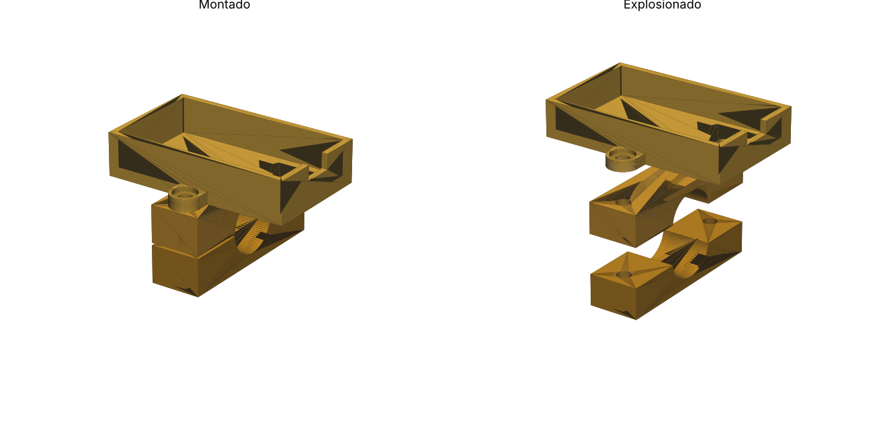

# Soporte de manillar para marcador Koso

Diseño propio, paramétrico, inspirado en las fotos de referencia (no es una copia del modelo de pago de Cults3D).

Tres piezas, unidas con 2 tornillos M5x35 y 2 tuercas M5:

| Pieza | Descripción | Orientación de impresión |
|---|---|---|
| `Bandeja` | Caja abierta para el marcador, con orejetas, ranura y muesca para el cable | Fondo sobre la cama |
| `Abrazadera_Superior` | Media abrazadera lisa | Boca abajo (`stl/clamp_upper.stl` ya viene girada) |
| `Abrazadera_Inferior` | Media abrazadera con alojamientos hexagonales para las tuercas | Hexágonos sobre la cama |

## Fusion 360
1. Copia la carpeta `fusion360/KosoManillarSoporte` en tu carpeta de scripts o añádela desde **Utilidades > Complementos > Scripts y complementos > +**.
2. Ejecuta `KosoManillarSoporte`: crea un diseño nuevo con los 3 cuerpos montados.
3. Clic derecho en cada cuerpo y elige **Guardar como malla** para exportar el STL.

Para cambiar las medidas, edita el bloque `P` al principio del script y vuelve a ejecutarlo.

## Medidas clave (por defecto)
- Manillar: Ø22,2 mm (7/8"). Para manillar de 1-1/8", pon `bar_d=28.6`.
- Interior de la bandeja: 70 × 40 × 14 mm. **Mide tu Koso** y ajusta `tray_in_x`, `tray_in_y` y `tray_depth` (deja unos 0,5 mm de holgura).
- Separación entre tornillos: 54,8 mm. Hueco de 1 mm entre las mitades para que apriete.

## STL sin Fusion
`python3 preview_build.py preview.png` regenera los STL en `stl/` y la imagen de vista previa (necesita `manifold3d`, `trimesh` y `matplotlib`).
Recomendado: PETG o ASA (aguantan sol y vibración), 4 perímetros, 30 % de relleno.
